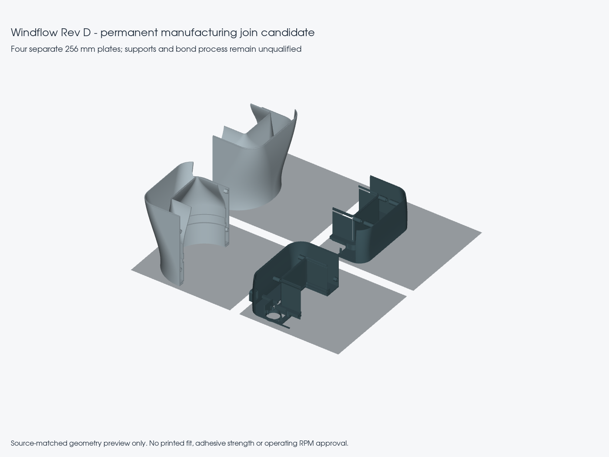
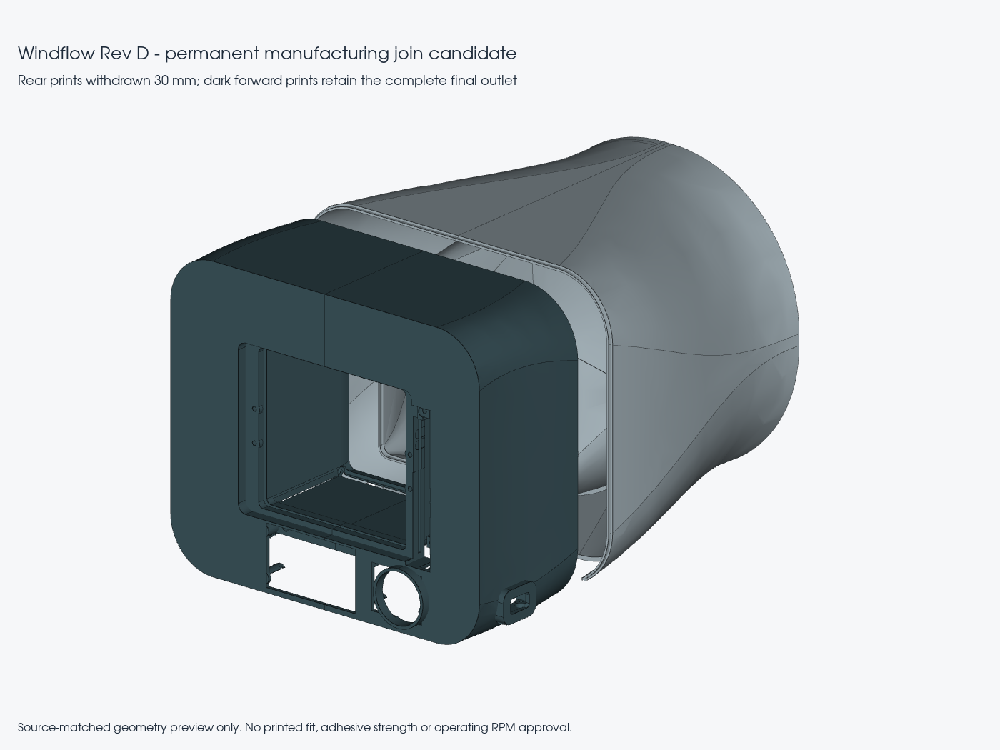

# Permanent enclosure print join — development candidate

The 275 mm full head halves are awkward for a common 256 mm printer. This separate manufacturing candidate divides each current enclosure half into a rear print and a forward print. The final outlet, panel hinges, grille seat and front controls remain in the forward print. Permanently bond the two prints into one enclosure half **before installing hardware**. The nozzle is integral to the enclosure and has no removable joint.

The complete 108-instance development assembly is unchanged. The [four-part exchange](../cad/rev_d/print-split/Windflow-Rev-D-permanent-print-join-CANDIDATE.step) is a manufacturing study for inspection, not a replacement assembly or an approved print process. The [immutable Onshape study](https://cad.onshape.com/documents/5ca1b5b26cd9a4a93dde4737/v/36ffd353b39e0aad30eccc72/e/fe781b063729fd0966288b7b) was saved and opened on 12 October 2026, with four named parts observed. Onshape translated this small hierarchy into a Part Studio. [The online record](../cad/rev_d/print-split/onshape-checkpoint.json) preserves import details and proof. Its shape derives from geometry commit `490e61d5d556170cc9f5e24441dd916cae07fa5e`.

## Geometry and tuning

[Parameters](../cad/rev_d/print-split/parameters.json) define a join at Y = 181 mm, a 2 mm straight axial lap, 0.2 mm bond clearance, 2 mm radius registration-pad masks and a 10 mm bed-edge reserve. Axes match the main assembly: airflow is +Y and dimensions are millimetres. This location keeps the join behind the boost-panel hinge region.

The lap partitions existing material; it adds no positive volume to the airpath, exterior or component pockets. A small bond allowance is removed from the parent. Registration pads restore material within the parent to locate axial assembly. Where the existing bottom service opening removes the outer wall, no bottom pad is forced into that opening. The ideal assembled airpath requires adhesive to fill the intended bond gap and a flush finish: an unfilled gap is not a sealed duct.

Earlier longer laps at more rapidly changing sections produced thin lips. The accepted location and shorter lap pass 108 radial lip samples, with a smallest sampled thickness of approximately 0.892 mm against a 0.8 mm acceptance floor. This is **sampled geometry**, not a proof of the global minimum wall thickness or adhesive strength. Thin lap regions still require careful printing, handling and bonding.

## Print files

The `-PRINT.stl` files in [the print-split folder](../cad/rev_d/print-split) already have their own bed orientation and translation. Do not apply the world-assembly orientation to them again. Rear pieces have a +90° X rotation; forward pieces have a −90° X rotation. Each sits at Z = 0 with X/Y beginning at 10 mm. STEP files retain world assembly coordinates.

| Print | Oriented X × Y × Z envelope, mm | Use |
|---|---|---|
| Left rear | 109.03 × 185.00 × 189.00 | Rear shoulder, inlet/carrier region |
| Right rear | 109.03 × 185.00 × 189.00 | Rear shoulder, inlet/carrier region |
| Left forward | 112.10 × 185.00 × 90.40 | Integral outlet and control/port region |
| Right forward | 109.03 × 185.00 × 85.00 | Integral outlet and control region |

These fit **four separate 256 × 256 mm beds**, including 10 mm reserve on both sides of each planar extent. They are not four parts packed onto one plate. The maximum height is 189 mm; confirm the actual printer build height. The reserve is an allowance for brim/support placement, not a generated support layout.

Print the outer-wall and duct-wall rear/forward coupon pairs first. Each coupon uses the actual local join geometry rather than an unrelated clearance gauge. Keep the corresponding rear/forward pair together. Evaluate fit, bond application, sealing and alignment with the intended material/process before printing the full shells. Coupon results cannot qualify the complete enclosure or rotor containment.

No support-free claim is made. Rear bulkhead features require slicer inspection for bridging or accessible support. Forward fascia features protrude beyond the front datum and need local support. Avoid support scars or strings on the internal duct; remove all supports before joining. Print the lap last from its full-thickness parent wall. Use the main enclosure's chosen material and establish layer/perimeter settings through the coupons; do not apply the rotor's settings automatically to the shell.

## Assembly order

1. Remove supports and inspect both paired prints, particularly the lap and local registration contacts. Reject distorted, cracked or poorly bonded layers.
2. Dry-fit the rear and forward pieces by straight axial insertion. Confirm complete seating without force and without spreading either half.
3. Establish a compatible permanent adhesive and controlled cure procedure using the coupons. No adhesive model, purchased adhesive or bond-strength rating is frozen by this CAD milestone.
4. Align and permanently bond each half with the duct and exterior flush. Remove excess adhesive from the flow surface and hardware pockets; seal the bond gap. Keep the half-seam and all service openings clear.
5. Verify dimensions and access after cure. Only then install the carrier/TPU ring, stator, linkage, electronics and looms according to the main assembly sequence. The two completed enclosure halves still use the main service seam.

The joining path requires an empty shell. The 122 sampled comparisons withdraw/reinsert one forward print from 0 to +30 mm relative to its paired rear print. They do not authorize bonding an already populated fan or prove tool/support access in a slicer.

## Verification and limits

[Validation](../cad/rev_d/print-split/validation.json) records valid single-solid STEP round trips, eight accepted watertight STL articles (four shell prints and four coupons), oriented bed envelopes, 108 lip samples and 122 nominal axial insertion comparisons with zero positive-volume overlap. The original exterior/airpath envelope is respected. Offset-divider curves are converted to STEP-compatible NURBS with bounded sampled numerical deviation; this avoids a reader reopening the derived shape as an open shell.

[The four-part exchange report](../cad/rev_d/print-split/integration-export-validation.json) confirms four named groups and four reopened solids with approximately 0.03003 mm³ total volume difference. [Preview provenance](../cad/rev_d/print-split/preview-record.json) ties the images to the accepted articles. A preview is not an extra engineering check.

Reproduce with the configured CAD runtime: run `cad/rev_d_print_split.py`, then `tools/export_rev_d_print_split.py` and `tools/render_rev_d_print_split.py`. Parent source/report hashes must match before the scripts proceed. Failed mesh trials stay in the ignored build directory and cannot replace an accepted print file.

Unfinished work includes slicer/support review, coupon and full-part warping/fit, adhesive selection/cure/strength/creep, seal quality, joint handling, repeated thermal exposure and a complete structural review. This study grants no blade-containment claim and no rotor operating approval. It does not alter firmware motion inhibition.

